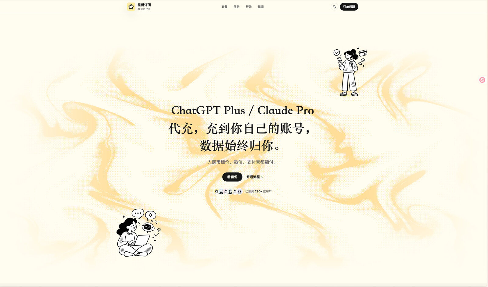

<div align="center">

# ChatGPT Session Tool

Paste a ChatGPT Session once to make a login cookie, look up the subscription, or cancel auto-renew.<br>
Zero dependencies. The credential stays on your machine.

[简体中文](README.md)

<sub>Sponsors</sub>

<a href="https://xingqiaosub.com/?utm_source=github&utm_medium=readme&utm_campaign=chatgpt-session-tool"><picture><source media="(prefers-color-scheme: dark)" srcset="docs/img/sponsor-xingqiao-dark.png"></picture></a>

Xingqiao activates ChatGPT and Claude on your own account. Prices are in RMB. Pay with WeChat or Alipay, and your chats stay on your account.<br>
290+ people have used it, and invoices are available. Before you submit a Session, this tool shows the email, the plan, and auto-renew.

<br>

<a href="https://xingqiaosub.com/?utm_source=github&utm_medium=readme&utm_campaign=chatgpt-session-tool"></a>

**[Open Xingqiao](https://xingqiaosub.com/?utm_source=github&utm_medium=readme&utm_campaign=chatgpt-session-tool)** &nbsp;·&nbsp; **[Plans](#plans)**

</div>

## What this tool does

1. **Login cookie** — wrap `sessionToken` as `__Secure-next-auth.session-token` in Cookie-Editor format. Import it in the browser to restore the session. This step runs in the page. The credential never leaves your machine.
2. **Subscription lookup** — plan, expiry, auto-renew, and where it was bought (web, iOS, or Android in-app).
3. **Cancel auto-renew** — open the official subscription portal (Stripe). Access stays until the period ends, then billing stops.

## Quick start

Node **18+** (built-in `fetch`). No dependencies, no `npm install`:

```bash
node server.js          # or npm start
```

Open http://127.0.0.1:8787.

| Variable | Default | Meaning |
| --- | --- | --- |
| `PORT` | `8787` | Listen port |
| `HOST` | `127.0.0.1` | Bind address. Localhost only by default. Set `0.0.0.0` to expose it on the LAN (not recommended; see Security). |

## Tests

```bash
npm test
```

## Get a Session

While logged in to chatgpt.com, open:

```
https://chatgpt.com/api/auth/session
```

Copy the whole JSON into the box at the top of the page.

## How it works

```
Browser (index.html)  ──►  local proxy (server.js, 127.0.0.1)  ──►  chatgpt.com/backend-api
      ▲                                                                  │
      └──────────── response stays on this page ◄────────────────────────┘
```

- **Cookie conversion** runs in the browser. `sessionToken` is wrapped for Cookie-Editor. It does not go through the proxy or leave the machine.
- **Subscription lookup.** The proxy calls `accounts/check/v4-2023-04-27` for the account list, then `/subscriptions` on each account for the expiry date and `will_renew`.
- **Cancel renewal.** The proxy calls the official `payments/customer_portal` and opens that link. The last confirmation happens on OpenAI's page. Official endpoints only.

## Security

- The server **binds to 127.0.0.1 by default**. The access token stays on your machine.
- The page sends a strict CSP (`script-src 'self'` and related directives) plus `X-Frame-Options`, `nosniff`, and other response headers.
- Upstream responses and error text are HTML-escaped before they are rendered.
- A Session is a temporary login key. When you are done, use ChatGPT "log out of all devices" to revoke it. Signing in from an unusual place, or automating the account, can trip risk checks.

## Limits

- Lookup and cancel go through the local proxy to `chatgpt.com`. A home IP is the least likely to be blocked by Cloudflare. On HTTP 403, retry from another network.
- **Mobile in-app subscriptions** (App Store / Google Play) have to be cancelled in that store. The official web portal cannot do it, and the page says so.
- Free accounts often get 404 from `/subscriptions`. That is expected.
- Upstream fields move. The code reads them optionally and keeps fallbacks. Small updates may be needed when the official API changes.

## Plans

Activation is for your own login. Live prices are on [xingqiaosub.com](https://xingqiaosub.com/?utm_source=github&utm_medium=readme&utm_campaign=chatgpt-session-tool).

ChatGPT Plus covers everyday writing, research, and images. Claude Pro fits when you want Claude to edit code and run scripts. Move up a tier when you outgrow the plan.

| Plan | Xingqiao | Official list price |
| --- | --- | --- |
| ChatGPT Go | ¥99 / month | $8 / month |
| ChatGPT Plus | from ¥165 | $20 / month |
| ChatGPT Pro | from ¥850 | $100 / month |
| Claude Pro | from ¥299 | $20 / month |
| Claude Max / Ultra | from ¥999 | $100 / month |

Individual orders are monthly. After the included Codex or ChatGPT Work allowance runs out, add ChatGPT Credits: 500 credits from ¥199, valid for 12 months, on an account that already has Plus or Pro. Teams of 5 or more can email [support@xingqiaosub.com](mailto:support@xingqiaosub.com) for team pricing.

A free account can open any ChatGPT or Claude plan listed on the site. ChatGPT Plus, or a lower Pro tier, can move up to a higher Pro tier. Claude Pro opened through Xingqiao can move up to Max or Ultra. An upgrade is charged at the full price of the new plan. The amount already paid is not refunded or credited, and a new 30-day period starts on the upgrade date.

### Three steps

1. Confirm the account is yours and you can sign in, then pick a plan and pay.
2. After payment, submit a login credential and the account email. For ChatGPT, paste the [Session](https://chatgpt.com/api/auth/session). For Claude, submit the Session Key. The credential is used for that order: check the current subscription, then finish activation.
3. An order email goes to that address. About 10 minutes later, refresh your own account and the subscription is there. WeChat payments are matched to the transfer first.

A new Claude activation needs your own free account, with KYC already completed. The signup region, the phone number's region, and where you usually sign in should match.

After ChatGPT is active, open Settings → Security → Active sessions and log out of every session. That revokes the Session you submitted. The subscription and your chat history stay on the account.

Electronic invoices add 7% of the order amount, with a minimum of ¥50 per invoice. The line item is 「生产生活服务\*技术服务」. After payment, send the company name and tax ID to Xingqiao support.

If a ChatGPT plan is not activated, Xingqiao refunds the order in full after checking it. If Claude is not activated and the account is not banned, the refund deducts only card or processor fees that cannot be recovered. Read the [refund policy](https://xingqiaosub.com/support/refund-policy) and the [account security notes](https://xingqiaosub.com/support/security) before you pay.

## License

[MIT](LICENSE)
