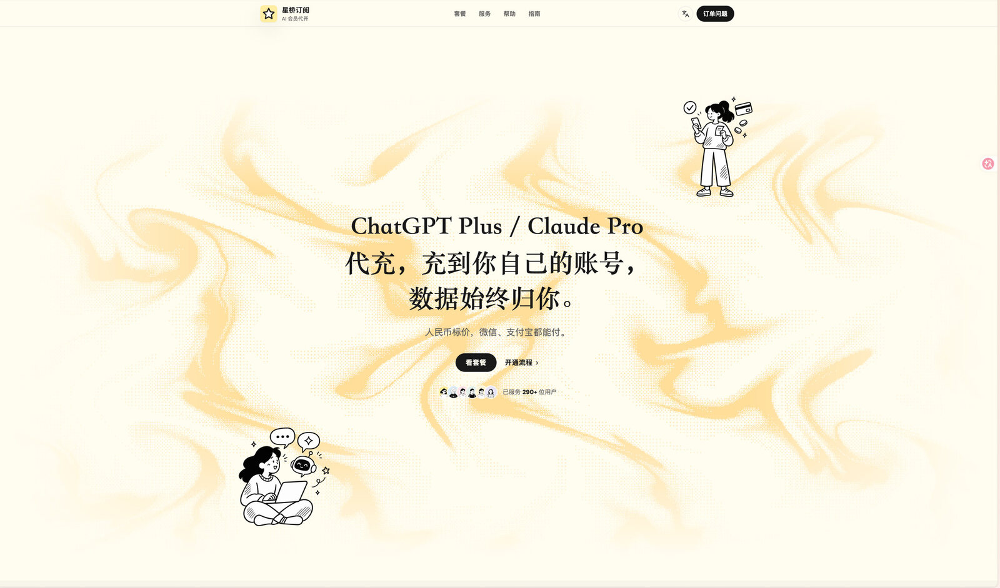

<div align="center">

# ChatGPT Session 工具

粘贴一次 ChatGPT Session，在本机转成登录 Cookie、查看订阅、取消自动续费。<br>
零依赖，凭证留在你自己的电脑上。

[English](README.en.md)

<sub>Sponsors</sub>

<a href="https://xingqiaosub.com/?utm_source=github&utm_medium=readme&utm_campaign=chatgpt-session-tool"><picture><source media="(prefers-color-scheme: dark)" srcset="docs/img/sponsor-xingqiao-dark.png"></picture></a>

星桥订阅把 ChatGPT 与 Claude 开通到你本人的账号。人民币标价，微信、支付宝都能付，聊天记录留在你的账号里。<br>
已服务 290+ 位用户，可开电子普通发票。提交 Session 之前，用这个本地工具先看清邮箱、套餐和自动续费。

<br>

<a href="https://xingqiaosub.com/?utm_source=github&utm_medium=readme&utm_campaign=chatgpt-session-tool"></a>

**[打开星桥订阅](https://xingqiaosub.com/?utm_source=github&utm_medium=readme&utm_campaign=chatgpt-session-tool)** &nbsp;·&nbsp; **[套餐](#套餐)**

</div>

## 这个工具能做什么

1. **转登录态 Cookie** —— 把 `sessionToken` 转成 `__Secure-next-auth.session-token`（Cookie-Editor 格式），在浏览器里 Import 即可恢复登录态。纯前端完成，凭证不出本机。
2. **查询订阅** —— 套餐 / 到期日 / 自动续费状态 / 来源平台（官网、iOS、安卓内购）。
3. **取消自动续费** —— 一键打开官方订阅管理页（Stripe），关闭续费后权益保留到到期日，到期后不再扣款。

## 快速开始

需要 **Node 18+**（使用内置 `fetch`）。零依赖，无需 `npm install`：

```bash
node server.js          # 或 npm start
```

打开 http://127.0.0.1:8787 即可使用。

| 环境变量 | 默认值 | 说明 |
| --- | --- | --- |
| `PORT` | `8787` | 监听端口 |
| `HOST` | `127.0.0.1` | 监听地址。默认只绑本机；如需局域网访问改成 `0.0.0.0`（不推荐，见安全说明） |

## 运行测试

```bash
npm test
```

## 获取 Session

登录 chatgpt.com 后，在浏览器地址栏打开：

```
https://chatgpt.com/api/auth/session
```

把整段返回的 JSON 复制粘贴进页面顶部输入框即可。

## 工作原理

```
浏览器 (index.html)  ──► 本地代理 (server.js, 127.0.0.1)  ──► chatgpt.com/backend-api
      ▲                                                        │
      └────────── 响应只回本页，不出网络 ◄───────────────────────┘
```

- **Cookie 转换**：纯前端，把 `sessionToken` 包装成 Cookie-Editor 的导入格式，不经过代理，也不出本机。
- **查询订阅**：代理调用 `accounts/check/v4-2023-04-27` 拿账号列表，再对每个账号调 `/subscriptions` 取最准的到期日与 `will_renew` 状态。
- **取消续费**：代理调用官方 `payments/customer_portal` 拿管理链接，最后一步在官方页面确认——只做官方接口，不做逆向猜测。

## 安全说明

- 服务**默认只绑定 127.0.0.1**，accessToken 只在你自己的机器上流转。
- 页面带严格 CSP（`script-src 'self'` 等）与 `X-Frame-Options` / `nosniff` 等安全头。
- 上游响应、错误信息等动态内容全部经 HTML 转义后渲染，防注入。
- 对你的凭证负责：Session 等同临时登录钥匙，用完可在 ChatGPT「退出所有设备」收回；异地/自动化操作账号有触发风控的风险。

## 已知边界

- 查询/取消走本机代理请求 `chatgpt.com`。本地跑=住宅 IP，最不容易被 Cloudflare 拦；若返回 403，换干净网络重试。
- **手机内购订阅**（App Store / Google Play）必须在对应商店里取消，官方管理页管不了，页面会提示。
- 免费账号调 `/subscriptions` 常返回 404，属正常现象。
- 上游字段可能漂移，代码全部做了可选读取 + 保底值，随官方 API 变化可能需小幅适配。

## 套餐

只给本人账号开通。价格以 [xingqiaosub.com](https://xingqiaosub.com/?utm_source=github&utm_medium=readme&utm_campaign=chatgpt-session-tool) 当页为准。

日常写东西、查资料、做图，选 ChatGPT Plus。想让 Claude 直接改代码、跑脚本，选 Claude Pro。用量不够再升级。

| 套餐 | 星桥价 | 官网标价 |
| --- | --- | --- |
| ChatGPT Go | ¥99 / 月 | $8 / 月 |
| ChatGPT Plus | ¥165 起 | $20 / 月 |
| ChatGPT Pro | ¥850 起 | $100 / 月 |
| Claude Pro | ¥299 起 | $20 / 月 |
| Claude Max / Ultra | ¥999 起 | $100 / 月 |

个人用户按月开通。Codex、ChatGPT Work 的套餐额度用完后，可加购 ChatGPT Credits，500 点 ¥199 起，购买后 12 个月内有效；账号需正在订阅 Plus 或 Pro。5 人以上可邮件 [support@xingqiaosub.com](mailto:support@xingqiaosub.com) 咨询团队价。

免费账号可以开通页面上的 ChatGPT 或 Claude 套餐。ChatGPT Plus 或更低档 Pro 可以升到更高档 Pro；在星桥开通的 Claude Pro 可以升到 Max 或 Ultra。升级按新套餐全价付款，之前已付的金额不退不抵，30 天从升级当天重算。

### 三步开通

1. 确认账号是你本人的，并且能正常登录，再在价格区选择套餐付款。
2. 付款后提交登录凭证，并填写充值邮箱。ChatGPT 粘贴 [Session](https://chatgpt.com/api/auth/session)，Claude 提交 Session Key。凭证只用于这一笔订单：提交前核对当前订阅，然后完成开通。
3. 订单邮件发到充值邮箱。大约 10 分钟后刷新你自己的账号，就能看到订阅。微信支付会先核对收款。

Claude 新开通需要本人账号、免费版，并且已经通过 KYC。注册地区、验证手机号归属地和日常访问地区保持一致。

开通完成后，在 ChatGPT「设置 → 安全 → 活跃会话」里退出所有会话，即可让这次提交的 Session 失效。订阅和聊天记录仍在你的账号里。

电子普通发票按订单金额加收 7%，每张最低 ¥50，项目名称为「生产生活服务\*技术服务」。付款后联系星桥支持，备注抬头（公司名称）和税号。

ChatGPT 未开通成功的，核实后全额退款。Claude 未开通且账号未被封禁的，退款仅扣除实际无法退回的支付手续费。下单前请阅读 [退款政策](https://xingqiaosub.com/support/refund-policy) 与 [账号安全说明](https://xingqiaosub.com/support/security)。

## License

[MIT](LICENSE)
